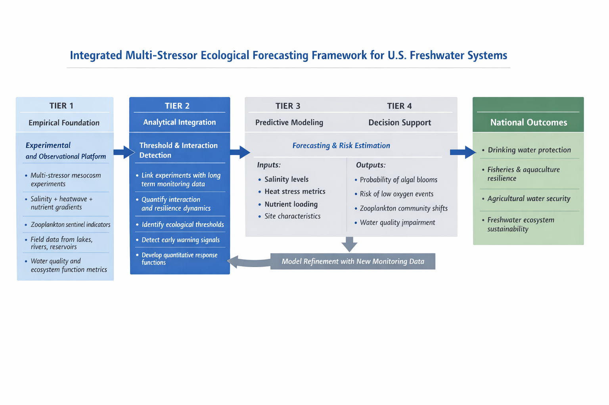

# freshwater-multistressor-forecasting-methodology

# Methodology

My proposed endeavor will be implemented through an integrated framework that combines controlled ecological experiments, long-term freshwater monitoring data, predictive modeling, and management-oriented translation. This methodology is designed not only to understand how freshwater salinization, climate-driven heatwaves, and nutrient loading interact in U.S. lakes, rivers, and reservoirs, but also to convert that understanding into practical forecasting and decision-support tools that can help managers anticipate and reduce water-quality risks before they become crises.

## 1. Multi-Stressor Experimental and Field Data Generation

The first stage of the methodology focuses on generating high-quality ecological and water-quality data under realistic freshwater conditions. I will continue to use mesocosm experiments to simulate different levels and combinations of chloride contamination, heatwave exposure, and nutrient loading, while also incorporating targeted field sampling and long-term monitoring records from U.S. lakes and reservoirs. This stage is essential because it provides the empirical foundation needed to understand how multiple stressors affect freshwater organisms and ecosystem function in ways that single-stressor studies often miss.

This stage will involve:

- designing and conducting mesocosm experiments that manipulate salinity, temperature, and nutrient levels individually and in combination;
- monitoring zooplankton communities as biological indicators, including changes in abundance, biomass, diversity, community composition, and respiration;
- measuring associated water-quality variables such as dissolved oxygen, conductivity, pH, and nutrient concentrations; and
- linking these results with field observations and long-term lake-monitoring datasets from systems such as Lake Champlain and other state-monitored water bodies.

The expected outcome of this stage is a set of mechanistic and observational data showing how freshwater ecosystems respond to combined salinity, heat, and nutrient stress under both experimental and real-world conditions.

## 2. Integration of Long-Term Monitoring and Ecological Analysis

The second stage focuses on integrating experimental findings with long-term environmental records so that ecological patterns observed under controlled conditions can be tested against natural freshwater variability. This is important because the value of the endeavor lies not only in identifying stressor interactions in experiments, but also in determining whether those interactions explain what happens in actual U.S. lakes and reservoirs over time.

This stage will involve:

- organizing and harmonizing data from mesocosm studies, field sampling, and historical lake-monitoring programs;
- evaluating how salinity, heatwaves, and nutrient conditions relate to changes in zooplankton communities and ecosystem processes;
- identifying thresholds, early-warning indicators, and recovery dynamics associated with ecosystem stress; and
- analyzing how stressor history, including prior chloride exposure, influences resistance, resilience, and ecological "memory."

The expected outcome of this stage is a clearer understanding of the ecological thresholds and response patterns that can be used to support model-building and risk assessment.

## 3. Predictive Model Development and Forecasting

The third stage translates experimental and observational results into predictive ecological models that can estimate the likelihood of harmful freshwater outcomes under different environmental conditions. This stage is the core of the endeavor because it moves the work from ecological description to forecasting capacity.

This stage will involve:

- applying mixed-effects models, multivariate community analyses, resilience and recovery metrics, and scenario-based forecasting approaches;
- using these tools to estimate the probability of outcomes such as harmful algal blooms, oxygen depletion, and major shifts in zooplankton community structure;
- incorporating, where appropriate, machine-learning methods to identify nonlinear responses, complex interactions, and high-risk conditions across lakes with different histories and stressor profiles; and
- building reproducible analytical workflows in R that allow the models to be refined as new monitoring or experimental data become available.

The expected outcome of this stage is a set of predictive ecological models capable of forecasting freshwater vulnerability under different combinations of salinity, heat, and nutrient stress.

## 4. Translation into Decision-Support Tools

The final stage ensures that the outputs of the research can be used in practice by non-specialists, including water-resource managers, drinking-water utilities, fisheries and aquaculture operators, and environmental agencies. Rather than ending with scientific analysis alone, the methodology is designed to produce outputs that can directly inform monitoring, planning, and adaptation.

This stage will involve:

- converting model results into risk indicators, summary graphics, scenario comparisons, and forecasting outputs;
- identifying where and when lakes, rivers, or reservoirs are most vulnerable to combined water-quality stress;
- developing outputs that can support decisions related to drinking-water treatment, road-salt management, nutrient reduction, fisheries protection, and watershed monitoring priorities; and
- sharing findings through peer-reviewed publications, technical reports, presentations to managers, and other practitioner-oriented communication channels.

The expected outcome of this stage is a set of usable, science-based decision-support tools that help shift freshwater management from reactive response to proactive prevention.

Through this four-stage methodology, my endeavor combines experimental ecology, real-world monitoring, advanced modeling, and practical translation in a single integrated framework. This makes it well suited to generating both scientific insight and management-relevant tools for protecting U.S. freshwater systems under multiple environmental stressors.

## Why This Methodology Improves on Current Freshwater Assessment Practice

Conventional freshwater assessment and management approaches often examine salinization, heatwaves, and nutrient loading separately, even though these stressors frequently occur together in real lakes, rivers, and reservoirs. My proposed methodology introduces a more integrated and predictive framework that is better suited to the complex, multi-stressor conditions affecting U.S. freshwater systems today.

| Current practice | Limitation | Methodology introduced by my endeavor |
|---|---|---|
| Water-quality assessment often treats salinity, temperature, and nutrients as separate issues. | This can miss the way multiple stressors interact to push lakes and reservoirs toward harmful blooms, oxygen loss, and ecological disruption. | My methodology uses integrated multi-stressor experiments and models to evaluate how salinization, heatwaves, and nutrient loading act jointly, producing a more realistic basis for forecasting freshwater risk. |
| Monitoring programs often rely heavily on chemical measurements alone. | Chemical data are important, but they may not capture early biological signs of ecosystem stress before visible water-quality failure occurs. | My methodology incorporates zooplankton as biological sentinels of environmental change, allowing early-warning detection of ecological stress alongside standard water-quality indicators. |
| Many studies remain descriptive or retrospective, explaining what has already happened. | Retrospective analysis is valuable, but it gives managers limited ability to prevent future events. | My methodology combines mesocosm experiments, long-term monitoring data, and predictive modeling to generate forecasting tools that can estimate future risk under different stressor scenarios. |
| Scientific findings are often published in forms that are not easily usable by managers and utilities. | This limits the practical value of the science for drinking-water protection, fisheries management, and watershed planning. | My methodology is designed to produce decision-support outputs such as risk indicators, scenario comparisons, and manager-friendly forecasting products that can support real-world action. |

This comparison shows that my proposed methodology is not simply another ecological study, but a practical improvement over current freshwater assessment practice. By moving from single-stressor, retrospective, and chemistry-dominated approaches toward an integrated, biologically informed, and predictive framework, it offers a more effective basis for protecting U.S. drinking-water sources, fisheries, and freshwater ecosystems.
